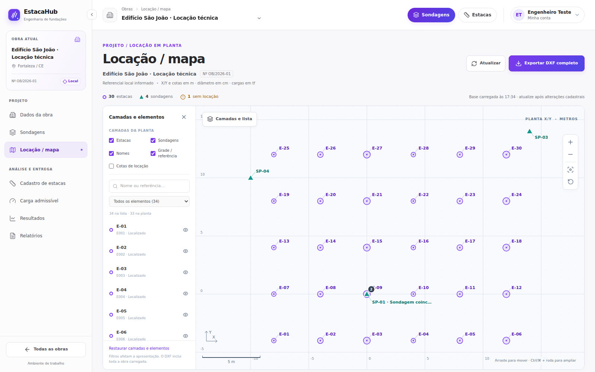
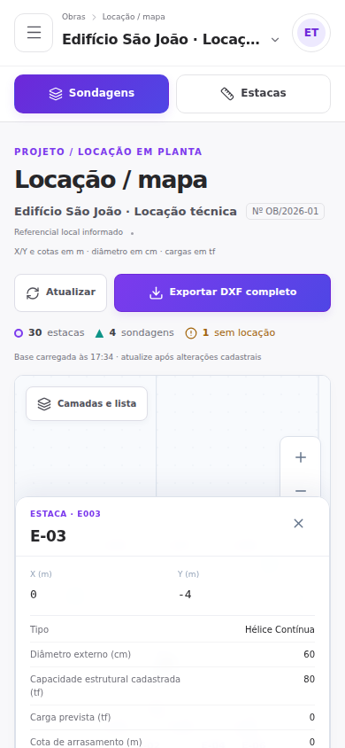
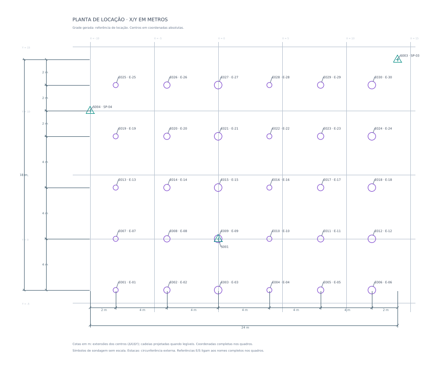
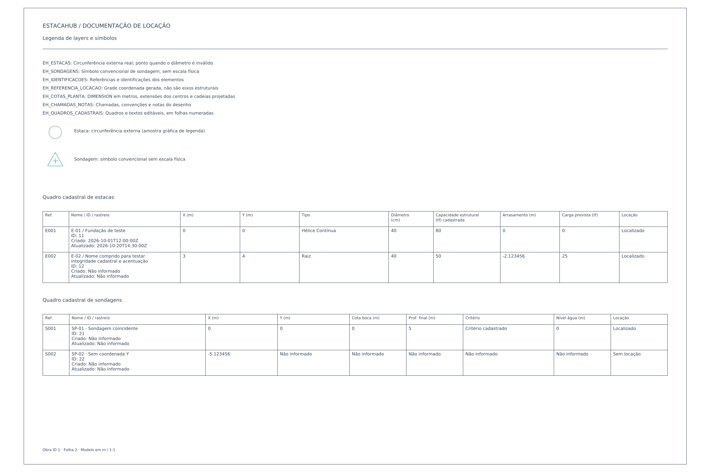

# Locação / mapa e DXF completo

Implementação e verificação em 28/10/2026. As imagens e as fixtures deste documento são dados isolados de teste, sem informações de uma obra de produção.

## Uso

1. Abra `/obras/:obraId/locacao-mapa`. Os três GETs existentes carregam obra, estacas e sondagens, incluindo as leituras.
2. Arraste a planta; amplie pelos botões ou por **Ctrl/⌘ + roda**. A roda comum rola a página. Com foco na planta: setas movem, `+`/`-` ampliam, `Home`/`0` enquadram toda a obra e `Escape` encerra a navegação por toque.
3. Abra **Camadas e lista**, pesquise e selecione um registro. A busca filtra a lista; camadas e visibilidade individual controlam a planta. A câmera não muda ao selecionar, ocultar ou restaurar camadas. Use **Enquadrar visíveis**, **Restaurar enquadramento geral** ou **Enquadrar elemento** quando desejar.
4. Pontos coincidentes têm contagem no mapa, alternância por clique e lista no inspetor. Os centros não são deslocados. O quadro inferior preserva as coordenadas cadastrais.
5. No celular, camadas e inspetor ocupam painéis inferiores. Ative o botão da mão para mover com um dedo ou ampliar com pinça; desative-o ou use Escape para voltar à rolagem por toque.
6. Clique em **Exportar DXF completo**. O worker gera e baixa um DXF nativo da base consultada, independentemente de câmera, seleção, busca e camadas. **Atualizar** consulta novamente a API após alterações cadastrais.

Exportação fica bloqueada durante carregamento/atualização, em falha de qualquer uma das três consultas e em obra sem registros. Se todos estiverem sem posição, a interface informa que haverá apenas quadros/pendências. Durante a geração, cliques duplicados e atualização são impedidos. A troca de obra desmonta a instância anterior, termina seu worker e ignora respostas atrasadas.





## Geometria, referencial e cotagem

- Coordenadas X/Y e atributos altimétricos em **metros**, diâmetros cadastrados em **centímetros**, cargas em **tf**, conforme os formulários existentes. DXF em escala geométrica **1:1**, `$INSUNITS=6`, `$MEASUREMENT=1`, versão **AC1021 / UTF-8**.
- Coordenadas absolutas, sinais e números retornados pela API são usados diretamente. A inversão de Y só existe na projeção da tela. Z=0 é o plano do desenho, não a cota de boca/arrasamento.
- Estacas: `CIRCLE` externa com raio `diametroCm / 200`. Se não houver diâmetro válido, somente `POINT`, sem raio fictício. Halo/centro da interface são convenções de interação, diferentes da circunferência física.
- Sondagens: `INSERT` de bloco interno triangular convencional, sem escala física do furo. Não há informação de diâmetro de sondagem.
- Somente X **e** Y finitos dão posição. Ausências permanecem nulas; zero é válido. Itens sem posição constam em todos os quadros aplicáveis e no quadro de pendências.
- Grade gerada identificada como **referência de locação**. Local/UTM é o sistema informado; não há dedução de fuso, hemisfério, datum, EPSG, latitude/longitude, norte, terreno ou eixos estruturais.
- Cotas nativas `DIMENSION` lineares com ângulo explícito e bloco gráfico interno por dimensão. Estilo `EH_METROS` com `DIMSCALE=1`, `DIMLFAC=1`, seis casas de precisão de apresentação e sufixo m. A medição geométrica não é arredondada.
- Cotagem das extensões dos centros projetados em X/Y. Cadeias projetadas somente com 3–10 ordenadas distintas e intervalos suficientemente legíveis. Quando existem exatamente dois centros distintos, inclui também sua distância direta. Não há todas as distâncias entre pares. Coordenadas absolutas de cada registro estão nos quadros.
- Nomes curtos podem acompanhar as referências E/S junto ao centro. Nomes extensos ficam completos nos quadros correspondentes. Chamadas externas são usadas quando não há lugar livre. Os mesmos princípios de composição de rótulos são compartilhados com os mapas.



## Conteúdo cadastral e disposição

Os quadros incluem todos os campos de obra solicitados retornados pela API, cadastros completos de estacas e sondagens, leituras por furo, identificadores/datas disponíveis, legenda, convenções e elementos sem posição. Capacidade estrutural é o **valor cadastrado**, sem cálculo geotécnico. “Gerado em” e “base consultada em” são separados das datas de atualização dos registros.

Foto: somente a legenda retornada é pertinente ao desenho; a API atual fornece metadados/URL fictícia e nenhum byte. Não há imagem embutida, upload ou acesso à URL da foto.

Folhas numeradas em model space, com até três colunas e afastamento da planta/anotações. Seções pequenas compartilham folha; tabelas repetem cabeçalhos nas continuações. Nomes/observações não são truncados e registros extensos continuam nas folhas seguintes. Texto e linhas dos quadros são entidades editáveis. As quebras são explícitas, com estimativa conservadora de largura; `MTEXT` com largura zero evita que cada leitor introduza quebras diferentes. Controles não imprimíveis são substituídos por espaços; barras, chaves, percentuais e códigos de caret são neutralizados antes de serializar.



| Layer | Conteúdo |
| --- | --- |
| `EH_ESTACAS` | Circunferências físicas ou centros sem diâmetro |
| `EH_SONDAGENS` | Símbolos convencionais |
| `EH_IDENTIFICACOES` | Identificações/referências |
| `EH_REFERENCIA_LOCACAO` | Grade coordenada |
| `EH_COTAS_PLANTA` | Dimensões nativas e seus blocos |
| `EH_CHAMADAS_NOTAS` | Chamadas, notas e amostras de legenda |
| `EH_QUADROS_CADASTRAIS` | Quadros, textos e folhas |

Cores e espessuras por layer. Blocos e estilos definidos no arquivo; nenhum XREF ou imagem externa. Fonte de texto padrão Arial, sujeita à substituição de fonte do leitor CAD.

## Arquitetura e arquivos alterados

| Arquivo/grupo | Responsabilidade |
| --- | --- |
| `src/pages/workspace/LocacaoMapa.jsx` e `.css` | Substituição do placeholder, cabeçalho, estados, integração e download |
| `src/hooks/useLocacaoData.js` | Carregamento conjunto pelos serviços existentes; revisão de dados e falhas parciais |
| `src/components/workspace/locacao/PlantaLocacao.jsx` | Viewport responsivo, câmera, mouse/teclado/toque, grade, símbolos e rótulos |
| `src/components/workspace/locacao/PainelElementos.jsx` | Camadas, busca, filtro, lista e visibilidade |
| `src/components/workspace/locacao/ElementoDetalhes.jsx` | Inspetor, coincidências, atributos e leituras |
| `src/utils/locacao.js` | Normalização canônica compartilhada; contrato do minimapa preservado |
| `src/utils/locacaoCamera.js` | Projeção uniforme, limites, enquadramento, pan, zoom e grade |
| `src/utils/locacaoRotulos.js` | Composição de rótulos compartilhada entre mapas e layout CAD |
| `src/utils/valorCadastro.js` | Apresentação de ausências sem transformar zeros |
| `src/utils/estacas.js` | Conversor numérico rejeita objetos, arrays e booleanos |
| `src/components/workspace/estacas/MiniMapaLocacao.jsx` | Reutilização da composição de rótulos, mantendo seleção/formulário/CRUD |
| `src/utils/dxf/layoutLocacao.js` | Layout independente de viewport, geometria, cotas, paginação e quadros |
| `src/utils/dxf/serializarDxf.js` | Entidades/tabelas/blocos/estilos DXF via biblioteca |
| `src/utils/dxf/texto.js` | Texto, quebras, escapes e nome seguro de arquivo |
| `src/utils/dxf/exportarLocacao.js` | Orquestração do gerador puro |
| `src/workers/locacaoDxf.worker.js` | Geração fora da thread da interface |
| `tests/fixture.js`, `tests/locacao.test.js`, `tests/dxf.test.js` | Fixtures isoladas e testes unitários/parser |
| `tests/e2e/locacao.spec.js`, `playwright.config.js` | Fluxos Chromium desktop/mobile, API simulada só nos testes |
| `scripts/gerar-fixture-dxf.mjs`, `scripts/verificar_dxf.py`, `scripts/requirements-cad.txt` | Geração e verificação CAD independente reproduzível |
| `package.json`, `package-lock.json`, `eslint.config.js`, `.gitignore` | Dependências, comandos e exclusão de artefatos temporários |
| `docs/locacao-mapa-dxf.md`, `docs/verification/*.png` | Decisões, evidências e roteiro |

Backend: `tests/test_locacao_contract.py`, `requirements-dev.txt` e `docs/locacao-mapa-contract.md`. Sem alteração de endpoint, schema, tabela, persistência ou comportamento de produção. Os GETs existentes já fornecem o necessário; nenhum endpoint de exportação foi criado.

A tela mantém os serviços e `credentials: include`, evento de sessão expirada e isolamento existente. Um refresh publica apenas os resultados daquela consulta; uma falha nunca mantém a aparência de exportação completa. Zoom/visibilidade são estado local de apresentação. A funcionalidade realiza somente GETs e não altera cadastros, banco ou armazenamento local.

## Dependências

- Runtime: `@tarikjabiri/dxf@2.9.0`, MIT, sem dependências transitivas próprias.
- Desenvolvimento: `@playwright/test@1.56.1`, `dxf-parser@1.1.2`.
- QA CAD opcional: Python `ezdxf` e `matplotlib`, em `scripts/requirements-cad.txt`; não entram no bundle.
- Backend: `httpx` somente em `requirements-dev.txt` para TestClient; requisitos de produção preservados.

A biblioteca não representa automaticamente as dimensões. Por isso são criados blocos gráficos e ângulos explícitos. A API 2.9 não expõe espessura de LAYER; um adaptador acrescenta group code 370 através do próprio `Dxfier`, sem remontar DXF por concatenação. Parser e auditoria verificam esses atributos.

Referências primárias consultadas: [biblioteca: entidades](https://dxf.vercel.app/guide/entities.html), [header/unidades](https://dxf.vercel.app/guide/header.html), [tabelas/estilos](https://dxf.vercel.app/guide/tables.html), [Autodesk: DIMENSION](https://help.autodesk.com/cloudhelp/2024/ENU/AutoCAD-DXF/files/GUID-239A1BDD-7459-4BB9-8DD7-08EC79BF1EB0.htm), [ezdxf: dimensões](https://ezdxf.readthedocs.io/en/stable/dxfentities/dimension.html).

## Verificação executada

```bash
npm ci
npm run lint
npm test
npx playwright install chromium
npm run test:e2e
npm run build
python -m pip install -r scripts/requirements-cad.txt
npm run verify:cad
```

Backend, em ambiente Python isolado com os requisitos exatos do projeto:

```bash
pip install -r requirements-dev.txt
python -m unittest discover -s tests -v
python -m compileall -q app tests
```

| Resultado | Evidência |
| --- | --- |
| Aprovado | ESLint e build Vite de produção |
| Aprovado | 11 testes unitários, normalização, câmera, DXF e textos |
| Aprovado | 9 testes Chromium; desktop 1600×1000, resize 1280×1000 e mobile 390×844 |
| Aprovado | Pan/clique, seleção em mapa/lista, coincidências, tooltip/foco, zoom ancorado, roda comum livre, teclado, enquadramento, camadas e sidebar |
| Aprovado | Pan por toque e pinça com eventos reais de toque via protocolo do Chromium |
| Aprovado | Falha parcial bloqueia DXF; recuperação por refresh; sessão 401 redireciona; resposta atrasada não mistura obras |
| Aprovado | Download real por Web Worker, repetido com todas as camadas ocultas; leitura independente dos downloads |
| Aprovado | Origem zero, negativos, grandes coordenadas, ponto único, alinhados, coincidentes, vazio e apenas sem posição |
| Aprovado | 500 leituras e observações extensas preservadas/paginadas na fixture isolada |
| Aprovado | CRUD original de estacas (criar/editar/excluir) e minimapa, em API simulada isolada |
| Aprovado | 3 testes HTTP do backend: contratos/aliases, precisão/zeros/leituras, autenticação, isolamento e ausência de escrita nos GETs |
| Aprovado | 3 DXFs reabertos por `ezdxf`, auditados sem erros nem reparos; centros/diâmetros, unidades, layers/espessuras, textos e medição nativa conferidos |
| Aprovado | Fixture (0,0) e (3,4): 5 m; estaca Ø40 cm: 0,40 m no CAD |
| Aprovado | Inspeção visual das capturas desktop/mobile e renderização CAD independente, incluindo planta e folhas ampliadas |
| Não executado | Abertura em AutoCAD/BricsCAD/LibreCAD: esses aplicativos não estão instalados; a inspeção CAD disponível foi o renderer do ezdxf |
| Não executado | Sessão/obra e PostgreSQL de produção; testes usaram fixtures isoladas e SQLite no contrato HTTP |
| Não executado | Safari/Firefox e dispositivo móvel físico; gestos exercitados no Chromium |

Falhas intermediárias corrigidas: tipos de dimensão inclinada interpretados como projeção por leitor independente, texto de medida quebrando automaticamente, distribuição de seções em folhas e seletores dos testes de regressão. Nenhuma falha conhecida remanescente na suíte final. A página não resolve a legibilidade de qualquer densidade arbitrária: nomes em áreas densas ficam acessíveis por zoom, tooltip e lista; o DXF usa referências/quadros e chamadas externas quando necessário.

## Roteiro curto de demonstração

Abra a rota, recolha/expanda a sidebar, arraste e amplie. Selecione pela lista e clique em um centro coincidente. Oculte todas as camadas e exporte duas vezes: os arquivos mantêm os registros completos. Consulte um item sem locação no inspetor e nos quadros. Abra o arquivo no CAD, confira `$INSUNITS=6`, layers e uma dimensão; na fixture isolada, meça 5 m e Ø0,40 m. Execute o teste de falha parcial/troca de obra e a regressão de CRUD para reproduzir os casos sem tocar em produção.
